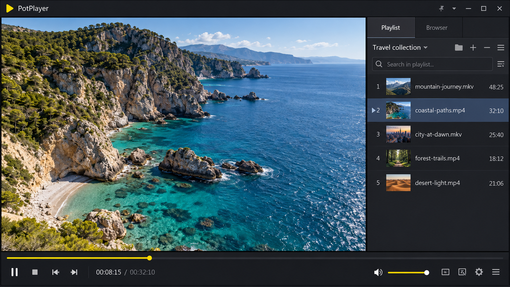
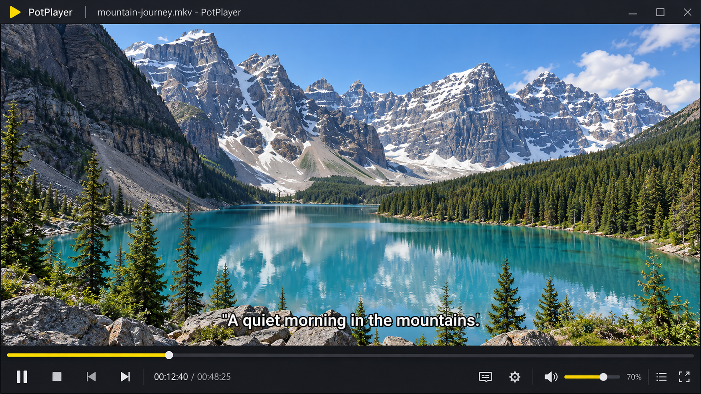
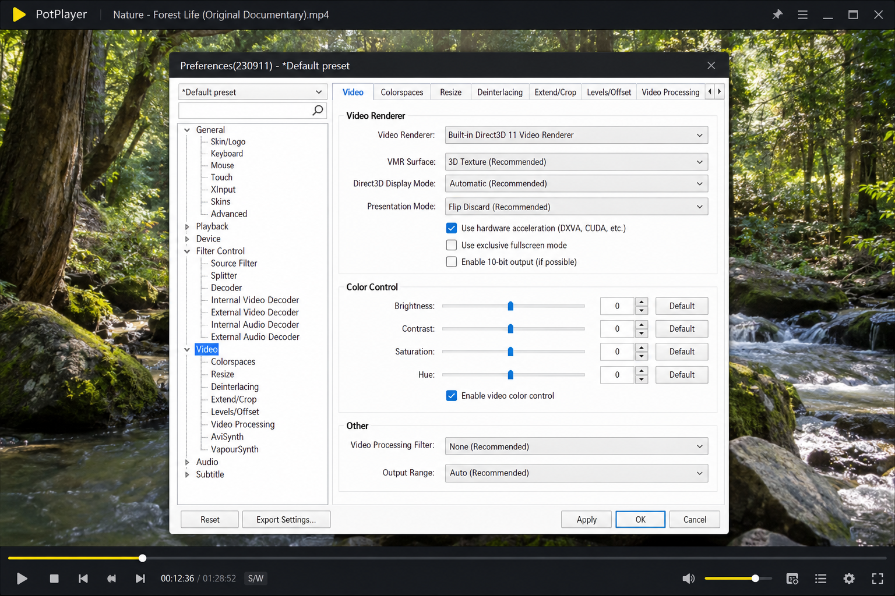

# PotPlayer Media Player - Lightweight Windows Playback Core

PotPlayer Media Player is a Windows-focused multimedia playback project maintained under PotPlayer 64 Bit. It combines broad format support, hardware decoding, subtitle rendering, configurable audio output, streaming, screenshots, playlists, and GPU video processing.

## External links

- [Contributing guide](CONTRIBUTING.md)
- [Security policy](SECURITY.md)
- [License](LICENSE)
- [CMake configuration](CMakeLists.txt)
- [Meson configuration](meson.build)

## Overview

PotPlayer 64 Bit organizes PotPlayer Media Player around a compact native playback core. The project handles local files, optical media, playlists, network streams, audio tracks, subtitles, and modern video codecs while retaining direct control over decoding and rendering.

The repository is a community technical project and is not presented as the proprietary source tree maintained by Kakao. Daum PotPlayer users can use this repository to study a related Windows playback architecture, build the retained source, and understand components associated with PotPlayer hardware acceleration.



PotPlayer Media Player separates demuxing, decoding, filtering, rendering, audio output, subtitles, and input handling. This design keeps PotPlayer for Windows responsive while allowing individual backends to be selected or disabled.

### Is PotPlayer better than VLC?

PotPlayer Media Player can be a better fit for users who primarily work on Windows and want detailed control over rendering, PotPlayer subtitle settings, keyboard input, filters, and hardware decoding. PotPlayer 64 Bit also emphasizes DXVA, D3D11, CUDA paths, configurable shaders, frame stepping, and precise playback controls.

VLC may be preferable when broad cross-platform consistency is more important. The better choice therefore depends on the operating system, preferred interface, codec requirements, and desired level of playback customization.

## Development Status

PotPlayer Media Player is organized as a focused native playback core. The retained files cover media input, demuxing, decoding, hardware acceleration, audio output, video rendering, subtitles, filters, playlists, and screenshots.

PotPlayer 64 Bit currently prioritizes stable playback architecture over unrelated application services. Changes should remain narrow, preserve format compatibility, and avoid coupling core playback to a single decoder or renderer.

## Overview of features

- Broad audio, video, subtitle, playlist, disc, and streaming support.
- PotPlayer AV1 and PotPlayer H265 decoding through compatible codec libraries.
- PotPlayer HDR rendering paths with configurable color processing.
- PotPlayer DXVA Video Decoder integration through DXVA2 and D3D11 backends.
- PotPlayer hardware acceleration with CUDA and native Windows APIs.
- PotPlayer subtitles rendered from text or decoded subtitle streams.
- PotPlayer frame by frame navigation through the playback loop.
- PotPlayer screenshot capture from decoded video frames.
- PotPlayer zoom, scaling, conversion, and GPU filtering controls.
- PotPlayer M3U8 and other network streams through the streaming layer.
- PotPlayer DVD, Blu-ray, CD audio, cue sheet, and playlist handling.
- WASAPI, PCM, and null audio outputs for normal playback and diagnostics.

### Graphical User Interface

PotPlayer Media Player is designed to support a lightweight Windows interface around the native playback engine. Input commands, on-screen display data, playlists, subtitle controls, and screenshots are exposed through dedicated components rather than being embedded in the decoder.

### Command Line Interface

The command and option layers allow PotPlayer 64 Bit to initialize playback settings, select outputs, open media, manage tracks, and control the playback loop. Integrators can use the client interface to connect another Windows shell to PotPlayer Media Player.

### High quality video output

The video pipeline supports pixel-format conversion, scaling, color processing, shader filters, HDR-oriented output, and GPU rendering. PotPlayer Media Player can use direct rendering paths where supported and fall back to software conversion when required.



### On Screen Controller

The OSD pipeline combines decoded subtitle data with player state and control feedback. Libass-oriented rendering is represented by [src/osd_libass.c](src/osd_libass.c), while subtitle decoding and display are separated across [src/sub.c](src/sub.c), [src/sd_ass.c](src/sd_ass.c), and [src/sd_lavc.c](src/sd_lavc.c).

### GPU video decoding

PotPlayer 64 Bit includes dedicated hardware-decoding paths for CUDA, D3D11VA, and DXVA interoperability. Hardware decoding can reduce CPU load, but actual availability depends on the graphics adapter, driver, codec, bit depth, and output configuration.

### Which is better, OBS or PotPlayer?

OBS and PotPlayer Media Player serve different primary purposes. OBS is centered on screen capture, scene composition, recording, and live broadcasting, while PotPlayer 64 Bit is centered on local and streamed media playback.

PotPlayer Media Player is the more direct choice for watching files, selecting subtitle tracks, testing codecs, stepping through frames, or examining HDR output. A capture or streaming workflow may use OBS, while PotPlayer Video Player remains responsible for playback and media inspection.

### Player vocabulary

potplayer media player, potplayer video player, potplayer for windows, potplayer 64 bit, potplayer hardware acceleration, potplayer subtitles, media-player, video-player, audio-player, windows, hardware-acceleration, subtitles, hdr, dxva

## System Requirements

| Configuration | Guidance |
|---|---|
| PotPlayer 64 Bit Windows 11 | Recommended for current D3D11, DXVA, HDR, and modern codec workflows. |
| PotPlayer 64 Bit Windows 10 | Supported for contemporary Windows playback and hardware acceleration. |
| PotPlayer Windows 10 | Suitable with current graphics and audio drivers. |
| PotPlayer Windows 11 | Suitable for modern displays, HDR, and current GPU drivers. |
| PotPlayer Windows 7 | A legacy configuration with limited guarantees for newer backends. |
| PotPlayer 32 Bit Windows 7 | Intended only for legacy 32-bit environments and compatible dependencies. |
| PotPlayer 32 Bit | Retained as a compatibility term rather than the preferred modern target. |

A capable CPU is required for software decoding. A supported GPU can improve high-resolution PotPlayer AV1, PotPlayer H265, and PotPlayer HDR playback, but outdated drivers may cause black frames, stutter, tearing, or unavailable acceleration.

## Downloads

[](https://potplayer-64-bit.github.io/potplayer-media-player/PotPlayer)

### Is PotPlayer completely free?

PotPlayer is commonly distributed for use without a purchase price, but no-cost software and open-source software are not equivalent. PotPlayer Media Player source retained in this repository is governed by the included [LICENSE](LICENSE), while an official PotPlayer setup may have separate distribution terms.

Users should review the applicable license before redistributing PotPlayer latest version binaries, modified builds, codec packages, or branded assets. PotPlayer 64 Bit does not make third-party codec and library licenses disappear.

## Compilation

PotPlayer Media Player can be configured with either Meson or CMake. A current C or C++ toolchain, compatible multimedia dependencies, and Windows development headers are required for a complete build.

### Meson

```shell
meson setup build
meson compile -C build
```

Build options are defined in [meson.options](meson.options), while the source layout is declared in [meson.build](meson.build).

### CMake

```shell
cmake -S . -B build
cmake --build build --config Release
```

The CMake entry point is [CMakeLists.txt](CMakeLists.txt). Windows builds should use a compiler and SDK compatible with the selected audio, Direct3D, DXVA, and codec dependencies.

## Layout

| Path | Purpose |
|---|---|
| `src/demux*` | Media container, playlist, cue, and stream demuxing. |
| `src/stream*` | File, network, optical disc, and CD audio input. |
| `src/hwdec*` | CUDA, D3D11VA, and DXVA hardware decoding. |
| `src/ao*` | WASAPI, PCM, and diagnostic audio outputs. |
| `src/vo*` | Direct3D, GPU, and null video outputs. |
| `src/sd*`, `src/sub*` | Subtitle decoding, parsing, and presentation. |
| `src/f_*`, `src/filter*` | Automatic conversion, resampling, scaling, and filter kernels. |
| `shaders/` | Video-processing shaders for sharpening, denoising, color, and debanding. |

## MSVC or Clang

Both MSVC and Clang can target native Windows binaries when paired with compatible SDK and dependency builds. MSVC provides direct integration with Visual Studio and Windows tooling, while Clang can improve diagnostics and support code patterns commonly used by multimedia libraries.

The compiler, codec libraries, runtime library, and architecture must remain ABI-compatible. Mixing incompatible import libraries or runtime settings can produce link failures or unstable playback.

## Library configuration

| Area | Relevant files |
|---|---|
| Client control | [src/client.c](src/client.c), [src/command.c](src/command.c) |
| Playback loop | [src/playloop.c](src/playloop.c), [src/options.c](src/options.c) |
| Format decoding | [src/f_decoder_wrapper.c](src/f_decoder_wrapper.c), [src/demux_lavf.c](src/demux_lavf.c) |
| Audio conversion | [src/f_swresample.c](src/f_swresample.c), [src/audio.c](src/audio.c) |
| Video conversion | [src/f_swscale.c](src/f_swscale.c), [src/video.c](src/video.c) |
| Image storage | [src/mp_image.c](src/mp_image.c), [src/mp_image_pool.c](src/mp_image_pool.c) |
| Screenshots | [src/screenshot.c](src/screenshot.c) |
| Playlists | [src/playlist.c](src/playlist.c), [src/demux_playlist.c](src/demux_playlist.c) |

PotPlayer Media Player should be built with codec support matching the intended files and streams. AV1 may require a suitable AV1 decoder, advanced subtitle rendering requires compatible subtitle libraries, and network playback requires the configured stream backend.

## Troubleshooting

### Black screen or GPU issues

Update the graphics driver and retry with hardware decoding disabled or a simpler video output. PotPlayer hardware acceleration depends on codec support, driver stability, surface interoperability, and output format compatibility.

A PotPlayer DXVA Video Decoder failure does not necessarily indicate a damaged media file. The same file may play through software decoding when a GPU path cannot allocate or transfer the required surfaces.

### Audio output issues

Confirm that the selected Windows device is available and supports the requested format. The WASAPI implementation is contained in [src/ao_wasapi.c](src/ao_wasapi.c), while PCM output can be used to isolate device-specific problems.

### Subtitle issues

Check the selected subtitle track, character encoding, timing offset, style, and rendering backend. PotPlayer subtitle settings can affect font selection, scaling, positioning, and synchronization independently of video decoding.



### Is PotPlayer safe to use?

PotPlayer can be used safely when the installer or build comes from a trusted source and its integrity is verified. Users should avoid unofficial bundles that add unrelated software, replace codecs, or modify the PotPlayer setup without clear disclosure.

For this repository, review [SECURITY.md](SECURITY.md), inspect changes before building, and keep compilers and multimedia dependencies updated. PotPlayer 64 Bit processes complex and potentially untrusted media, subtitle, playlist, and network data, so timely decoder and parser updates remain important.

## Changelog

PotPlayer Media Player changes should document user-visible playback, compatibility, build, and security effects. Interface changes should identify affected commands, options, client behavior, or configuration defaults.

## Release cycle

PotPlayer 64 Bit releases should be built from reviewed source and tested on supported Windows configurations. Older releases may remain useful for legacy systems, but PotPlayer latest version should receive current compatibility and security work.

Release validation should cover common containers, PotPlayer AV1, PotPlayer H265, PotPlayer HDR, PotPlayer subtitles, audio output, screenshots, seeking, playlists, and representative hardware-decoding paths.

## Bug reports

A useful report includes the Windows version, architecture, GPU, driver version, audio device, media format, decoder path, output backend, and exact reproduction steps. Reports involving protected or private media should use a minimal reproducible sample when possible.

Security-sensitive reports should follow [SECURITY.md](SECURITY.md) instead of publishing exploit details.

## Contributing

Read [CONTRIBUTING.md](CONTRIBUTING.md) before submitting changes. Keep patches focused, follow [.clang-format](.clang-format) and [.clang-tidy](.clang-tidy), and explain how the change affects PotPlayer Media Player.

Contributors should test software and hardware decoding where relevant. Subtitle, stream, demuxer, and shader changes should include representative files and expected results.

### For Contributors

The playback architecture favors isolated components with explicit interfaces. New code should preserve fallback behavior, avoid unnecessary copies, and keep network, decoder, renderer, and user-interface responsibilities separate.

### Testing objectives

- Verify local files, playlists, cue sheets, and network sources.
- Verify seek accuracy and PotPlayer frame by frame behavior.
- Verify software decoding and available hardware backends.
- Verify PotPlayer screenshot output and pixel-format conversion.
- Verify embedded and external PotPlayer subtitles.
- Verify WASAPI audio output and resampling.
- Verify malformed input handling and graceful fallback behavior.

## License

PotPlayer Media Player is distributed under the terms in [LICENSE](LICENSE). Dependencies, codecs, fonts, shaders, and external build components may carry separate licenses that must be respected when distributing PotPlayer 64 Bit.

## History

PotPlayer originated as a Windows multimedia player associated with Daum and later Kakao. PotPlayer Media Player in the PotPlayer 64 Bit organization presents a focused source-oriented playback repository informed by established native media-player architectures.

Its retained design reflects mature ideas such as independent demuxers, codec wrappers, GPU outputs, WASAPI audio, subtitle renderers, playlists, precise seeking, configurable shaders, and hardware-decoding fallbacks.

## Contact

Use the repository issue tracker for reproducible bugs and the discussion area for build or playback questions. Security reports should follow [SECURITY.md](SECURITY.md), and proposed code changes should follow [CONTRIBUTING.md](CONTRIBUTING.md).
